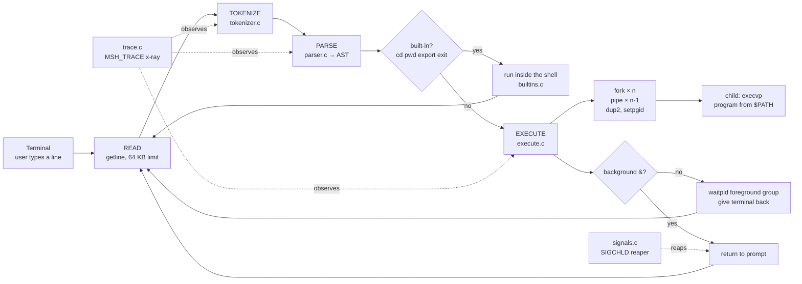

# msh — a Mini Unix Shell in C

A small Unix shell written from scratch in C on Linux. It runs external programs, pipelines of any length, file redirection and background jobs, handles Ctrl-C / Ctrl-Z / Ctrl-D correctly through process groups and signals, and has an **x-ray mode** that prints every system-call-level step (tokens, parse tree, `fork`, `pipe`, `dup2`, `waitpid`) while a command runs. Two switchable **bug modes** reproduce classic shell bugs (a leaked pipe descriptor, zombie processes) on purpose, so they can be seen and then fixed live.

Team project (Group 4) for *03603332 Operating Systems*, Computer Engineering and Informatics, Kasetsart University Sriracha Campus. I wrote all of the code (shell, tools and test suite); my teammates prepared the presentation slides.

---

## Problem & Objective

A shell is the most direct way to see the process API of an operating system in action. The objective was to build one that is small enough to read in one sitting but correct in the places where real shells are hard:

- Create processes with `fork` + `execvp`, connect them with `pipe` + `dup2`, and wait for them with `waitpid`.
- Run background jobs without leaving zombies (SIGCHLD reaper).
- Deliver Ctrl-C and Ctrl-Z only to the foreground job, never to the shell (process groups + terminal control).
- Never leak a file descriptor into a child, and never crash on bad input.
- Make all of the above **observable** for a live demo, and **testable** from outside the shell.

## System Architecture



| File | Stage |
|---|---|
| `src/main.c` | read loop, start-up, prompt, job-control initialisation |
| `src/tokenizer.c` | splits a line into tokens; metacharacters work without spaces (`ls>out.txt`, `ls\|wc -l`) |
| `src/parser.c` | builds the tree: command, pipe, redirection nodes; reports syntax errors |
| `src/execute.c` | `fork`, `execvp`, pipes, redirection, process groups, `waitpid` |
| `src/builtins.c` | `cd`, `pwd`, `export`, `exit` (run in the shell process, no fork) |
| `src/signals.c` | SIGCHLD handler that reaps background jobs |
| `src/trace.c` | x-ray output on a close-on-exec descriptor |
| `tools/ls.c`, `tools/cat.c` | our own `ls` and `cat`, built into `bin/` |
| `msh.c` | includes every `src/` file so one `gcc` command builds the shell |

### Supported syntax

| Feature | Example | Mechanism |
|---|---|---|
| External command | `ls -l` | `fork` + `execvp` searching `$PATH` |
| Built-ins | `cd lib`, `cd ~`, `pwd`, `export X=1`, `exit 3` | run in the shell process |
| Redirection | `wc -l < in.txt`, `ls > out.txt`, `echo a >> out.txt`, `ls nope 2> err.txt` | `open` + `dup2` onto 0 / 1 / 2 |
| Pipelines of any length | `cat data \| sort \| uniq -c \| sort -rn \| head -3` | n−1 pipes, n forks |
| Background job | `sleep 5 &` | skip `waitpid`, SIGCHLD reaps later |
| Ctrl-C / Ctrl-Z | during `sleep 30` | signal goes to the foreground process group only |
| Ctrl-D | at an empty prompt | `getline` returns −1, clean exit |

Not supported (by design, to keep the core small): quoting, globbing, `$VAR` expansion, `;` / `&&` / `||` (reported as "not supported", status 2), `fg` / `bg` / `jobs`, script files, line editing.

### Debug switches

| Variable | Effect |
|---|---|
| `MSH_TRACE=1` | x-ray: tokens, tree, each `pipe` / `fork` / `dup2` / `waitpid` |
| `MSH_TRACE=2` | also prints every child's descriptor table, to prove nothing leaks |
| `MSH_LEAK=1` | bug mode: the parent forgets to close a pipe end, so `ls \| wc -l` hangs because `wc` never sees EOF |
| `MSH_REAPER=0` | bug mode: SIGCHLD reaper off, so finished background jobs stay as zombies (`<defunct>` in `ps`) |

## Engineering Decisions

| Decision | Reason |
|---|---|
| **Tokenize → parse into a tree → execute** | Separating the stages makes each one testable and lets the x-ray show exactly what the shell understood before it runs anything. |
| **Built-ins run in the shell process** | `cd` and `export` must change the shell itself; a child's `chdir` would die with the child. Test case 17 (`cd /tmp \| cat`) shows the opposite case on purpose. |
| **Each job in its own process group, terminal handed to it** | Ctrl-C / Ctrl-Z reach only the foreground job. The shell ignores those signals and takes the terminal back after `waitpid`. |
| **`waitpid` with `WUNTRACED`** | A job stopped with Ctrl-Z returns control to the prompt instead of hanging the shell. |
| **SIGCHLD reaper for background jobs** | Finished background children are collected promptly, so no zombies accumulate. Bug mode `MSH_REAPER=0` shows what happens without it. |
| **Close every unused pipe end; x-ray channel is close-on-exec** | A single leaked write end keeps the reader waiting forever. `MSH_TRACE=2` prints each child's descriptor table so the claim is checked, not assumed. |
| **Hard limits on input** | Lines over 64 KB are rejected with a message and the shell keeps running; malformed lines (`\| ls`, `ls >`) give a syntax error, never a crash. |
| **Single-file build (`msh.c`)** | One `gcc` command builds the whole shell, which keeps the demo setup to one line on any Linux machine. |

### Verification

`tests/run_tests.py` starts msh inside a real pseudo-terminal and drives it like a person: it types lines, presses Ctrl-C / Ctrl-Z / Ctrl-D, and judges results only from the outside (screen output, files on disk, `/proc`, `ps`). Nothing inside msh is asked whether it worked.

Re-run for this repository on Ubuntu (WSL 2), gcc, Python 3:

| Suite | Result |
|---|---|
| Test-plan cases 01–12 (from the project slides) | 12 / 12 pass |
| Extra checks 13–29 (tokenizer, redirection errors, bug modes, x-ray, own `ls`/`cat`) | 17 / 17 pass |
| `valgrind --leak-check=full` on `tests/memcheck_input.txt` | shell process: all heap blocks freed, 0 errors |

**Known limitation:** if `$PATH` contains a directory the user cannot read (WSL adds Windows folders to `$PATH` by default), an unknown command reports `Permission denied` instead of `command not found`, because `execvp` returns `EACCES` in that case. bash searches `$PATH` itself and reports "command not found". With a normal Linux `$PATH` the case passes.

## Quick Start

Requirements: Linux (or WSL 2 on Windows), `gcc`, `python3`. Optional: `valgrind`, `strace`.

```bash
sudo apt install -y build-essential python3 procps     # Ubuntu / Debian
```

Build:

```bash
mkdir -p bin
gcc -std=gnu11 -Wall -Wextra -O2 -g -o msh msh.c
gcc -std=gnu11 -Wall -Wextra -O2 -g -o bin/ls tools/ls.c
gcc -std=gnu11 -Wall -Wextra -O2 -g -o bin/cat tools/cat.c
```

Run:

```bash
./msh                 # plain shell
./demo.sh             # guided demo: Enter types the next step from demo-steps.txt, Enter again runs it
./demo.sh --plain     # demo folder, you type everything
```

Try the x-ray and a bug mode inside msh:

```
export MSH_TRACE=1
ls -l | wc -l > out.txt &
export MSH_TRACE=0
export MSH_LEAK=1
ls | wc -l            # hangs: press Ctrl-C
export MSH_LEAK=0
```

Run the tests:

```bash
python3 tests/run_tests.py           # all 29 cases
python3 tests/run_tests.py 06 10     # selected cases
python3 tests/run_tests.py -v        # also show what msh printed
```

## Repository layout

```
msh.c            single-file build entry (includes src/*.c)
src/             main, tokenizer, parser, execute, builtins, signals, trace, msh.h
tools/           ls.c and cat.c → bin/
tests/           run_tests.py (pty-driven test plan), memcheck_input.txt
scripts/         playground.sh (demo folder), present.py (guided demo)
demo.sh          builds if needed and starts the guided demo
demo-steps.txt   the demo script
```
